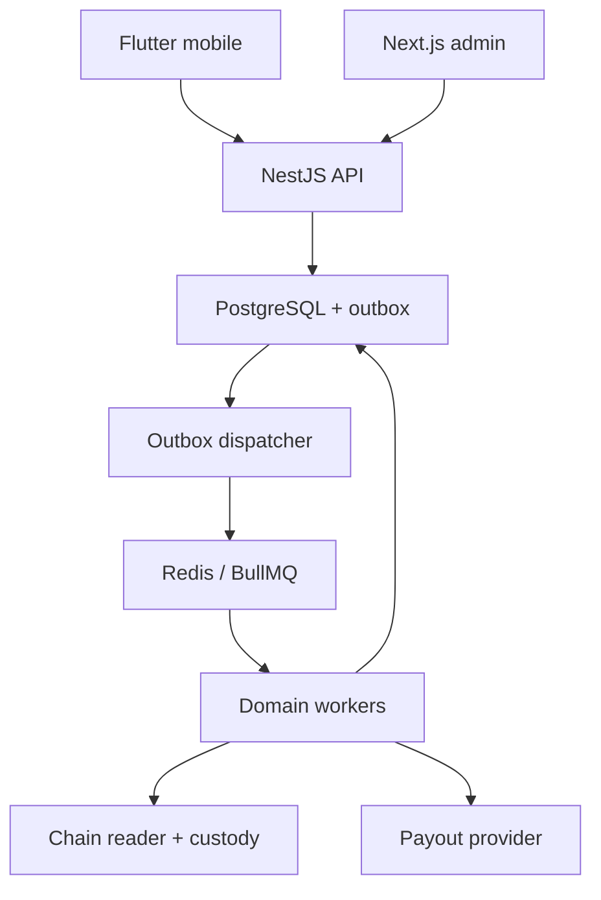
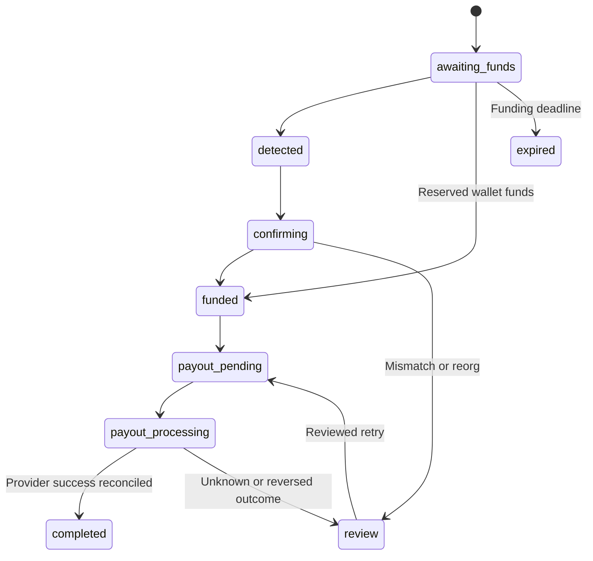

# Architecture · Phase 1

## Scope and decisions

DT Exchange is an original USDT-to-INR product. No DtOrbit branding, artwork, iconography, layouts or implementation was reused. The business direction is USDT sold for INR; INR receives its own ledger accounts. There is no crypto card or trading terminal.

Use a **modular monolith** first: a NestJS API and future separate worker process share PostgreSQL and domain contracts. This keeps financial transactions atomic while allowing chain indexing, provider calls and notifications to run outside request latency. Next.js and Flutter consume the same versioned REST API. Neither client owns money, verification decisions or authorization.

The API module boundaries and integration interfaces exist now. Redis/BullMQ dispatchers, chain readers, authentication and payout workers are planned, not running. The only implemented HTTP operations are `/health/live` and `/health/ready`.

## Stack

| Layer     | Choice                                                       | Ownership                                                      |
| --------- | ------------------------------------------------------------ | -------------------------------------------------------------- |
| Mobile    | Flutter / Riverpod / Dio / GoRouter / Flutter Secure Storage | Presentation, navigation, secure refresh-token storage         |
| API       | Node.js / NestJS / TypeScript                                | Authentication, authorization, validation, business operations |
| Database  | PostgreSQL 16+ / SQL migrations / `pg`                       | Durable financial and account state                            |
| Async     | Redis / BullMQ, introduced with workers                      | Delivery and scheduling; never authoritative balances          |
| Admin     | Next.js App Router / TypeScript                              | Operational presentation; permission checks on API             |
| Money     | PostgreSQL NUMERIC and BIGINT; decimal strings in REST       | Exact arithmetic, explicit precision and rounding              |
| Providers | Typed ports in `backend/src/contracts/integrations.ts`       | Custody, blockchain, verification, payouts                     |

SQL migrations are chosen over automatic ORM schema synchronization so triggers, deferred constraints and partial indexes are reviewable. Add migrations; never use an auto-sync mode in production.

## Domain boundaries

| Modules                           | Responsibilities                                                          | Implementation phase |
| --------------------------------- | ------------------------------------------------------------------------- | -------------------- |
| auth, users                       | Credentials, OTP, rotating refresh families, device sessions, user status | 3                    |
| verification, banks               | Account activation, provider decisions, verified payout accounts          | 3                    |
| rates                             | Rate modes, freshness, fees, limits, expiring immutable quotes            | 3                    |
| wallets, blockchain, deposits     | Custody-assigned address, chain indexing, confirmations, reorg handling   | 4                    |
| ledger, orders                    | Journal posting, funds reservation, accepted orders and tracking          | 4                    |
| payouts                           | Beneficiary snapshots, provider submission, reconciliation, reversals     | 5                    |
| referrals, notifications, support | Reward qualification, event delivery, user support                        | 6                    |
| admin, audit                      | Permission-checked operations, internal notes, append-only audit          | 7                    |

## Resolve the two sell funding paths

The brief combines a pre-funded wallet and a send-after-confirm flow. Both are supported in the architecture, with explicit `funding_source`.

| Mode      | Funding behavior                                                                                                     | Four-step UI interpretation                                  |
| --------- | -------------------------------------------------------------------------------------------------------------------- | ------------------------------------------------------------ |
| `wallet`  | Atomically reserve an existing ledger balance; never request a second on-chain deposit                               | Amount → Confirm → Send shows “Using wallet balance” → Track |
| `onchain` | Create an accepted order, receive at the assigned custody address, await trusted finality, credit once, reserve once | Amount → Confirm → Send QR/address → Track                   |

Phase 4 must serialize allocation against the user's wallet and pending order. A chain transfer has one deposit row. Each deposit can be allocated to at most one order; multiple deposits may fund an order. Do not allocate by amount alone. Partial, excess, late, unrecognized and reorganized transfers enter an explicit review/reconciliation path. Excess confirmed funds remain user liabilities. A quote expires before acceptance; after acceptance, its terms stay fixed through the funding deadline. A late transfer cannot silently accept a new rate.

“I Have Sent the USDT” is a progress hint only. It cannot create a deposit, credit a balance, increase confirmations or trigger a payout.

## Transaction state model

This is the planned service transition policy; the database enum is present, but transition authorization is implemented in Phases 4–5. Payout state is separate (`pending`, `processing`, `success`, `failed`, `reversed`). A timeout is an unknown outcome requiring reconciliation, never automatic permission to send again.

## Financial boundaries

- PostgreSQL is the source of truth. Do not cache an authoritative balance in Redis or calculate it from Flutter state.
- A posting creates a journal and at least two entries in one database transaction. Debits equal credits separately for each asset. INR precision is two decimal places; the consolidated USDT ledger supports up to 18, with network-specific raw token precision enforced by the chain adapter.
- User USDT balances are credit-normal liabilities. A confirmed deposit debits custody and credits the user's available balance. Reservations debit available and credit reserved. Sale and payout journal legs clear the corresponding liabilities; profit/fees use separate accounts. Exact posting templates and reversal matching are implemented and tested in Phase 4.
- Lock the user/asset account rows in a deterministic order, verify available funds, enforce daily/monthly limits and post the reservation atomically. Handle serialization/deadlock retries with bounded backoff. The Phase 1 schema does not alone prevent concurrent overspending; the transaction service and concurrency tests are required in Phase 4.
- Quotes snapshot USDT, accepted rate, gross/fee/net paise, bank, funding mode, fee/rate-policy versions and expiry. Order references an immutable quote rather than mutable global settings.
- Rounding: gross paise is `floor(USDT × INR rate × 100)`. Phase 3 fee computation must use exact decimal arithmetic, disclose rounding, and reconcile gross = fee + net. Version any additional deduction policy; do not infer it in the client.
- Permanent business keys identify deposits, journal events, quotes consumed by orders and payouts. Expiring API idempotency records do not replace these keys.
- Provider side effects use an outbox written in the same transaction as the state transition. Queue delivery is at least once. Consumers deduplicate and reconcile provider status. There is no claim of exactly-once network delivery.

## Security architecture

User and admin sessions are separate. Phase 3 will implement short-lived asymmetric JWTs, hashed rotating refresh tokens, family replay revocation, OTP hashes/expiry/attempt limits, login monitoring, account-state guards and server-side verification gates. Admin roles and permissions are normalized now; no privileged grants or admin accounts are seeded.

Sensitive database fields are ciphertext bytes or keyed lookup hashes. Phase 3 must implement versioned authenticated encryption using a managed key, purpose/record-bound associated data and a separate HMAC lookup key. No encryption service exists in Phase 1. Do not store plaintext in a column simply because it is named `ciphertext`. Passwords/PINs use slow password hashes; tokens/OTP use appropriate keyed hashes. Rotate keys through versioned envelope re-encryption migrations, preserving account identity protections.

Private keys never belong in application tables or environment templates. Use an approved custody provider/HSM signing service; the application stores address references only. Bank beneficiary snapshots are immutable, encrypted and tied to the accepted order. Verification documents use private encrypted object storage, short-lived authorized access and retention metadata.

Biometrics unlock a local session only; they do not replace API authorization. 2FA, PIN, device controls and security live under Settings. Verification is onboarding/account activation or a transaction gate, without new Profile menus.

## API conventions for later phases

Base `/api/v1`; authenticated ownership checks on every resource. JWT for mobile; admin BFF/HttpOnly secure cookies plus CSRF protection is the preferred browser boundary. Future cookie use requires the corresponding CSRF and origin checks; the current shell has no login/session cookies.

- Amounts, rates, block numbers, INR minor units and 64-bit totals are strings in JSON.
- Dates are UTC ISO 8601; display dates in the user's locale. Limits use the documented account timezone.
- Financial POST operations require `Idempotency-Key`; reuse with different request digest is 409.
- Resource versions support optimistic concurrency; list endpoints use cursor pagination.
- Error envelope: `{ "error": { "code": "...", "message": "..." }, "requestId": "..." }`.
- WebSockets may deliver advisory status changes. Clients still fetch authoritative state and never post ledger mutations directly.
- Webhooks require signature verification on the raw body, timestamp/replay checks, stored provider event IDs and a reconciliation poller.

## References

Toolchain/API conventions were checked against [NestJS first steps](https://docs.nestjs.com/first-steps), [Next.js installation](https://nextjs.org/docs/app/getting-started/installation), the bundled Next.js layout guide, [Flutter setup](https://docs.flutter.dev/install/manual), and [PostgreSQL constraints](https://www.postgresql.org/docs/current/ddl-constraints.html). These references inform implementation; they do not establish that the unfinished service is production-ready.

## Phase 4 implementation record

The current transaction implementation is documented in [Phase4_Blockchain_Architecture.md](phase4/Phase4_Blockchain_Architecture.md). It uses per-order custody addresses, database-backed state transitions and permanent hash/event ledger idempotency. Existing schema identities and financial snapshots are retained. No payout execution is active; extending the database transition guard is an explicit Phase 5 task.

## Phase 5 implementation record

The provider payout lifecycle, accounting, queues, authenticated callbacks, safe retries and reconciliation are documented in [Phase5_Payout_Architecture.md](phase5/Phase5_Payout_Architecture.md). A confirmed sandbox provider outcome can now settle the ledger and complete an order. No production banking adapter or real transfer is claimed. Existing earlier-phase scope notes are historical.

## Phase 6 extension

Engagement extends the existing modular monolith through NotificationService, ReferralsService, SupportService and SettingsService, plus the separate BullMQ engagement worker. See [Phase 6 hardening](phase6/Phase6_Production_Hardening.md) and [API](phase6/Phase6_API_Documentation.md). Financial services and the approved visual tokens remain authoritative. Migration 006 adds engagement fields without rewriting migrations 001–005.

## Phase 7 operational extension

Migration 007 adds transactional emergency controls, ledger integrity reporting and operational RBAC without changing prior financial snapshots. API and workers share a fail-closed production capability gate. See [production architecture](phase7/Phase7_Production_Architecture.md), [API additions](phase7/Phase7_API_Documentation.md) and [provider readiness](phase7/Phase7_Provider_Readiness.md).

## Phase 8 release boundary

RC1 preserves the established domains, financial model, UI and migrations through 007. Release evidence/configuration gates and isolated acceptance harnesses are added; no real provider is promoted from configuration alone. See phase8/Phase8_Developer_DevOps_Handover.md.
