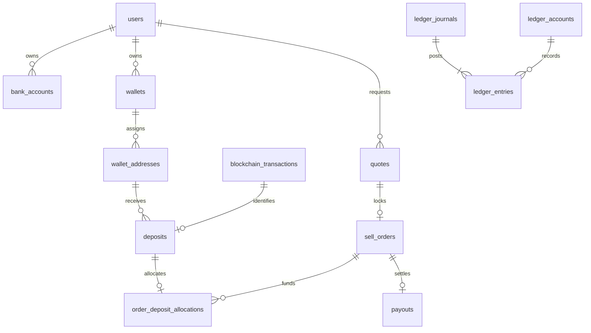

# Database guide

`backend/migrations/001_foundation.sql` creates **43 application tables and one ledger balance view**. The migration runner creates a separate `schema_migrations` table, uses a PostgreSQL advisory lock, applies each migration in a transaction and records a SHA-256 checksum. The initial migration may be refined before this package is delivered; after delivery it is immutable and future changes must be new migrations.

| Group                 | Tables                                                                                                |
| --------------------- | ----------------------------------------------------------------------------------------------------- |
| Accounts              | users, user_profiles, sessions, otp_challenges, login_history                                         |
| Admin access          | admin_users, admin_roles, admin_permissions, admin_role_permissions, admin_user_roles, admin_sessions |
| Verification/banking  | verification_records, verification_documents, bank_accounts                                           |
| Assets/custody        | assets, networks, token_contracts, wallets, wallet_addresses                                          |
| Blockchain/deposits   | blockchain_transactions, deposits                                                                     |
| Rates/orders          | exchange_rates, fees, rate_policies, quotes, sell_orders, order_deposit_allocations                   |
| Accounting            | ledger_accounts, ledger_journals, ledger_entries                                                      |
| Payouts               | payouts, payout_attempts, provider_events                                                             |
| Engagement/operations | referrals, referral_codes, notifications, support_tickets, internal_notes, risk_flags                 |
| Platform              | audit_logs, system_settings, idempotency_keys, outbox_events                                          |

## Enforced now

- Composite ownership foreign keys bind bank, wallet, address, deposit, quote and payout records to their user.
- Exactly one active default verified bank account per user; changing bank identity requires a new account record.
- Blockchain uniqueness is `(network_code, tx_hash, event_index)`, because one chain transaction may contain several transfer events. Contract identity is checked against the token registry. A transfer can create only one deposit row. Core transfer identity cannot be edited.
- Quotes are immutable. A quote can produce at most one sell order. Expired quotes cannot be accepted. Accepted order terms cannot be edited.
- Payout net paise must equal the accepted quote. One payout aggregate per order; multiple attempts remain under that aggregate. Beneficiary terms and idempotency keys are immutable.
- Ledger entries and journals are append-only. Every journal requires at least two entries and balances per asset at transaction commit. Entries cannot be appended to previously committed journals. Journal transaction IDs are stamped by the database. Asset precision is checked. Reversals reference another journal and cannot rewrite it.
- Audit records are append-only. Application code must provide sanitized contents; the database cannot infer whether arbitrary JSON contains personal data.
- Permanent unique event/request keys support deduplication independently from expiring API replay records.

## Implemented later in transaction services

The schema is not the complete business policy. Phase 3–5 services must enforce authentication and ownership, verification eligibility, freezes/suspensions, rate freshness, atomic limits, negative-balance prevention, funding allocation sums, selected network validity and token raw-amount normalization, chain finality and reorg policy, valid state transitions, exact reversal matching, signed provider callbacks and payout retry/reconciliation rules. Tests on a single-process PostgreSQL WebAssembly engine do not prove concurrent-worker behavior.

Use separate migration-owner, API and worker roles in Phase 8. The application must not be a superuser, own tables, bypass triggers, truncate history or issue arbitrary SQL. Append-only triggers are defense in depth, not protection from a database owner.

## Read amounts

USDT amounts use `NUMERIC(38,18)`; source raw units use `NUMERIC(78,0)` with token decimals in `token_contracts`. Rates use `NUMERIC(20,8)`. Quote/payout INR totals use BIGINT paise. JSON transports these as strings. Reject excess scale before inserts; PostgreSQL numeric columns can round on assignment. Do not convert numeric strings with `Number()`, `parseFloat()` or Dart `double` for calculations.

`ledger_balances` is a derived aggregate, not a mutable balance table. It uses each account's debit/credit normal side. No monetary column exists on `users` or `wallets`.

## Seeding and migrations

Reference seed can run repeatedly without deleting business data. It seeds USDT/INR, disabled networks, empty admin role definitions and disabled financial flags. Required confirmation counts are **development placeholders**, not an approved mainnet policy. No contract address or live quote is fabricated.

Migrate with `npm run db:migrate`, then `npm run db:seed`. There is no destructive down-migration for financial history. Use forward corrections or restore a verified backup under an explicit recovery procedure.
