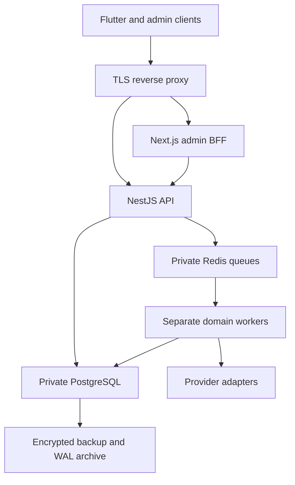

# Production architecture

The existing NestJS modular monolith remains the authority for transactions. Flutter and Next.js never calculate authoritative balances or send bank transfers directly.

Deploy independently scalable API, blockchain, payout and engagement processes. PostgreSQL is durable truth; Redis holds scheduling, not money. Reconciliation recovers uncertain delivery. Use managed multi-zone PostgreSQL and Redis or equivalent operated infrastructure, a private object store, and a separate monitoring network. Compose is a reference topology, not the only deployment option.

## Environment boundaries

| Environment | Runtime | Providers and data |
| --- | --- | --- |
| Development | NODE_ENV=development, DEPLOYMENT_ENV=development | Local generated keys and labelled mocks |
| Staging fixture validation | NODE_ENV=development, DEPLOYMENT_ENV=staging | Isolated mock database; never reachable as production |
| Production | NODE_ENV=production, DEPLOYMENT_ENV=production | Strict startup validation; currently blocked by missing registered adapters |

A production deployment label with a development runtime is rejected. For a future real-provider sandbox, register a reviewed adapter and use isolated sandbox credentials. Do not relabel development results as sandbox-vendor validation.

## Trust boundaries

Only the reverse proxy is public. The API accepts a specific trusted proxy CIDR only when configured; proxy forwarding headers are replaced, not copied from client input. Admin BFF connects to an HTTPS API origin. Restrict database, Redis and monitoring ports to service identities. Separate database owner/migration, application and read-only audit roles; never grant the runtime superuser or schema ownership.

Use a secret manager to mount per-service secret files. Signers belong behind custody/HSM/KMS services with independent authorization; the API stores addresses and references only. Encryption keys and backup decryption identities must be recoverable through controlled, separate access.

Budget database connections across replicas: replicas × PG_POOL_MAX plus migration/monitoring headroom must fit the server limit. Default pool is 10, configurable 1–100. Queries and transactions have bounded timeouts. Keep write transactions on the primary; replicas are unsuitable for financial eligibility decisions.

Monitoring uses structured logs, existing metric hooks, private SQL metrics and external dependency exporters. Expose neither metrics nor queue-management interfaces through the public proxy.
